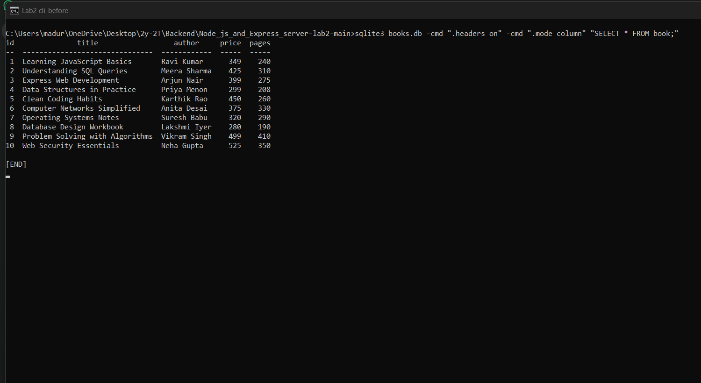
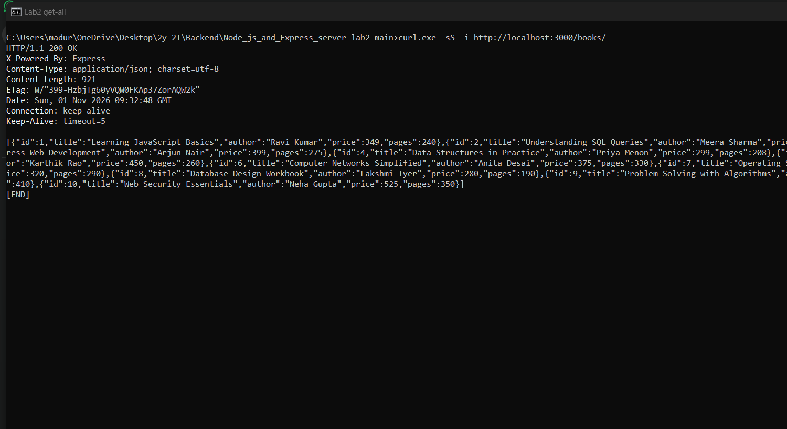
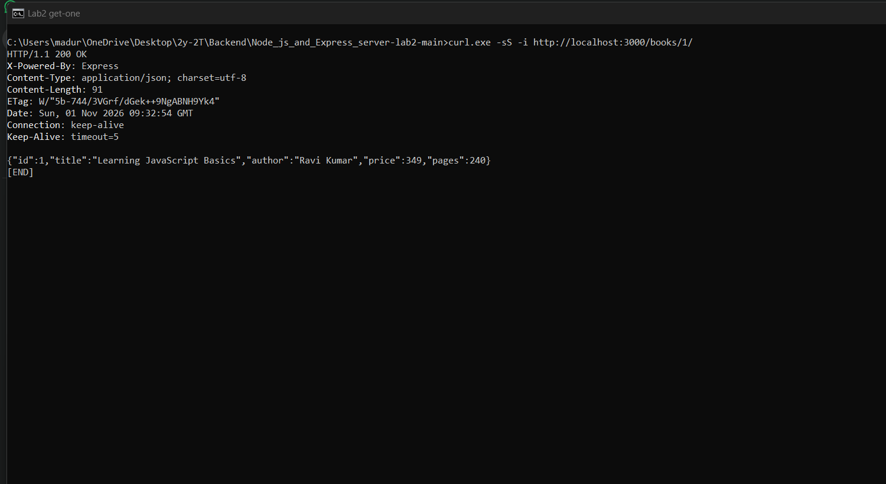
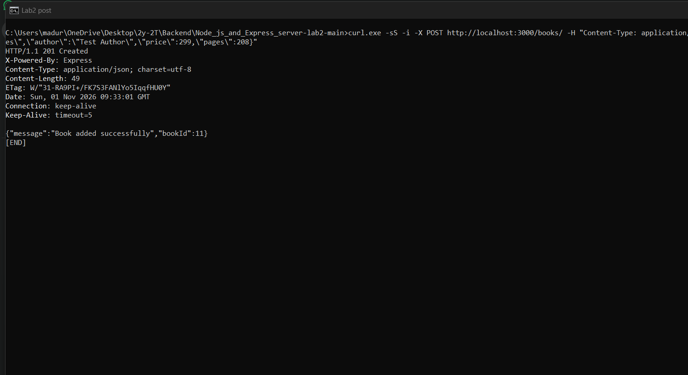
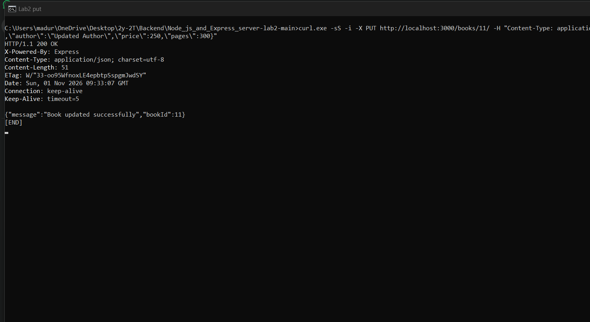
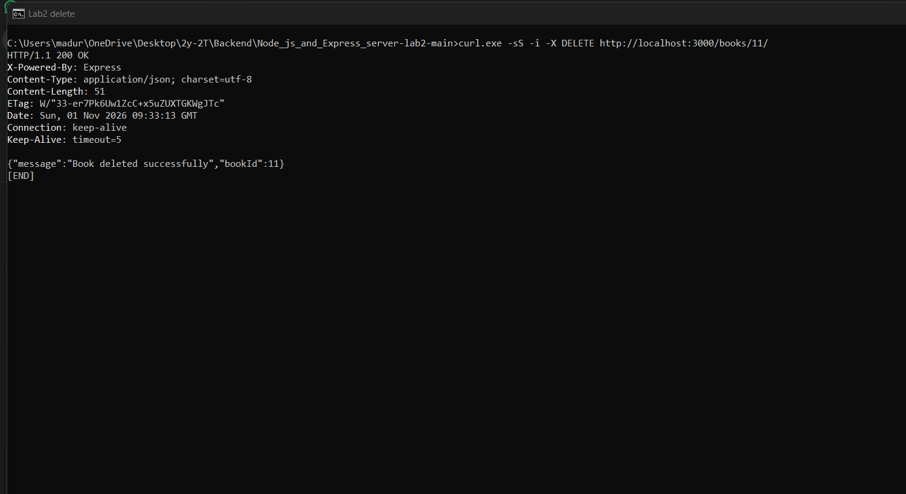
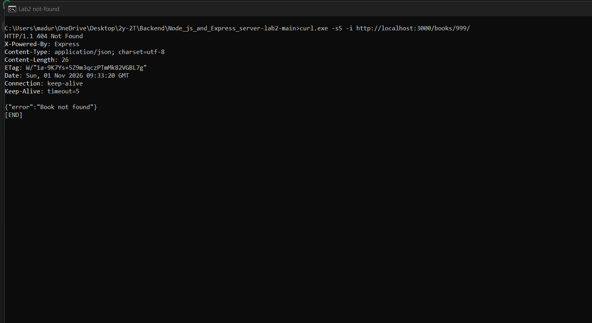
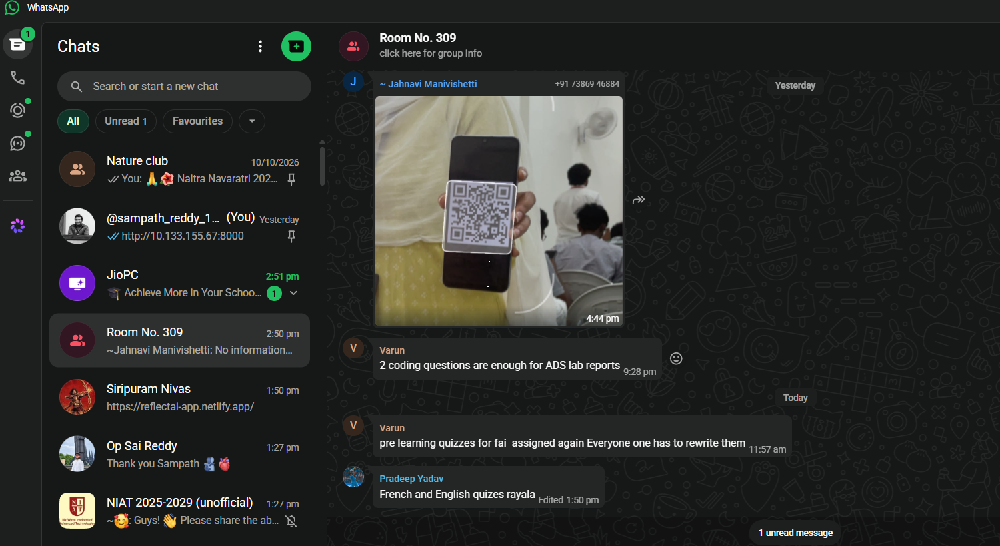

# Lab 2: SQLite database and CRUD routes

## Student Details

| Field               | Details                                |
| ------------------- | -------------------------------------- |
| **Name**            | Maduru Sampath Kumar Reddy             |
| **Registration No** | 252U1R7060                             |
| **Section**         | CSE FSD - [2B]                         |
| **Course**          | Backend Development Fundamentals       |
| **Lab Number**      | Lab 02                                 |

---

## Live Link

**Deployment pending.**

This lab has not been deployed, so no live URL is claimed. The project runs locally at `http://localhost:3000`.

### Hosting notes

- **Vercel is not suitable for this lab as written.** Vercel runs an Express app as serverless functions. The deployed files are not a durable writable disk, and Vercel's own guide on files recommends object storage for writes. SQLite needs a writable file that survives between requests, so `POST`, `PUT` and `DELETE` cannot reliably persist to `books.db` there.
- **Render is the recommended target.** Render runs a normal long-lived Node.js web service, which matches the single `app.listen()` in `server.js`. On the free plan the service spins down after 15 minutes without traffic and takes about a minute to start again. Render's filesystem is ephemeral, and free web services cannot attach a persistent disk, so `books.db` returns to the 10 committed rows whenever the service restarts, redeploys or spins down. That is acceptable for demonstrating the routes, but the data is not durable. A paid instance with a persistent disk (for example mounted at `/var/data`) would keep the file, but the database path in `server.js` would then need to point at that mount.
- **Not verified on Render:** no deployment was attempted. The `sqlite3` native binding was verified locally on Node.js 24; Render runs `npm install` on Linux during its build.
- **Remaining steps:** push the repository to GitHub (only with the owner's approval), create a Render Web Service with build command `npm install` and start command `npm start`, deploy, and test GET, POST, PUT and DELETE on the public URL. The URL should be added to this section only after all four methods work.

---

## Objective

The objective of this lab is to:

- Connect an Express server to a SQLite database file
- Open the database once when the server starts, using `sqlite` and `sqlite3`
- Create, read, update and delete rows in the `book` table over HTTP
- Return the correct status code for every outcome (200, 201, 400, 404, 500)
- Validate the `bookId` and the JSON request body before using them
- Protect every query with `?` placeholders so request input can never change the SQL
- Document the project with a README, screenshots and a clean project structure

---

## Technologies Used

- **Node.js** - JavaScript runtime environment
- **Express.js** - Web framework used to define the routes
- **SQLite** - File-based relational database (`books.db`)
- **`sqlite`** - Promise-based wrapper used with `async`/`await`
- **`sqlite3`** - Native SQLite driver used by the `sqlite` wrapper
- **npm** - Node Package Manager for installing dependencies
- **nodemon** - Development-only tool that restarts the server after file changes

---

## Project Structure

```text
Node_js_and_Express_server-lab2-main/
|-- server.js            # Express server, database connection and all CRUD routes
|-- seed.sql             # Table definition and the 10 starting rows
|-- books.db             # SQLite database generated from seed.sql
|-- package.json         # Project metadata, scripts and dependencies
|-- package-lock.json    # Exact dependency versions (auto-generated by npm)
|-- .gitignore           # Files excluded from Git
|-- README.md            # Project documentation (this file)
+-- screenshots/
    |-- cli-before.png   # book table before testing
    |-- get-all.png      # GET /books/
    |-- get-one.png      # GET /books/1/
    |-- post.png         # POST /books/
    |-- put.png          # PUT /books/11/
    |-- delete.png       # DELETE /books/11/
    |-- not-found.png    # GET /books/999/
    +-- cli-after.png    # book table after the tests and reset
```

> The eight screenshots must be captured manually after the tests (the PNG files are not included yet). The image links in the Screenshots section work once the files are saved into `screenshots/`.

---

## Package.json Fields Explained

| Field            | Description                                                                     |
| ---------------- | ------------------------------------------------------------------------------- |
| `name`           | The name of the project/package (`lab-02`)                                      |
| `version`        | The current version of the project (`1.0.0`)                                    |
| `description`    | A short description of what the project does                                    |
| `main`           | The entry point file for the project (`server.js`)                              |
| `scripts`        | Shortcut commands; `start` runs `node server.js`, `dev` runs `nodemon server.js` |
| `keywords`       | Array of keywords for npm discovery (empty in this project)                     |
| `author`         | Name of the author (`Maduru Sampath Kumar Reddy`)                               |
| `license`        | The license type (`ISC`, a permissive open-source license)                      |
| `type`           | Module system; `commonjs` means `require()` / `module.exports`                  |
| `dependencies`   | Packages required at runtime: `express`, `sqlite`, `sqlite3`                    |
| `devDependencies`| Packages needed only while developing: `nodemon`                                |

`package-lock.json` is generated by npm. It records the exact version of every installed package so that another machine gets the same install.

---

## Installation and How to Run

### Prerequisites

- Node.js installed (this project was tested with Node.js 24)
- npm, which comes bundled with Node.js
- The SQLite CLI (`sqlite3`) only if you want to rebuild or inspect the database by hand

### Steps to Install

1. Open a terminal in the project folder.
2. Install the dependencies:

```bash
npm install
```

3. Make sure `books.db` exists. If it is missing, rebuild it first:

```bash
sqlite3 books.db < seed.sql
```

### Start the Server

```bash
npm start
```

Expected output in the terminal:

```text
Connected to SQLite database at ...\books.db
Express server running at http://localhost:3000
```

Open `http://localhost:3000/books/` in a browser or HTTP client.

If the `book` table is missing, the server prints the real error and exits with code 1 instead of starting with a broken database.

### Start in Development Mode

```bash
npm run dev
```

This runs `nodemon server.js`, which restarts the server automatically after a file change. `nodemon` is a development dependency and is not needed in production.

The server reads the `PORT` environment variable if it is set, and uses `3000` otherwise. No environment variables are required.

---

## Database

The database file is `books.db`. It contains one table:

```sql
CREATE TABLE book (
    id INTEGER PRIMARY KEY,
    title TEXT,
    author TEXT,
    price INTEGER,
    pages INTEGER
);
```

`id` is an `INTEGER PRIMARY KEY`, so SQLite fills it automatically and never allows two books with the same id.

### Starting Rows

`seed.sql` contains the table definition and 10 starting rows. These ten books are **sample rows** created for this lab because no faculty row list was supplied. Replace them in `seed.sql` if a different list is required.

### Rebuild the Database

The seed script drops the old table first, so it can be run again safely:

```bash
sqlite3 books.db < seed.sql
```

### Inspect the Database with the SQLite CLI

```bash
sqlite3 books.db
```

Then run these commands inside the SQLite prompt:

```text
.headers on
.mode column
SELECT * FROM book;
.quit
```

### Why `books.db` is Committed

`books.db` is small (about 8 KB) and is committed on purpose so the project works immediately after cloning. `seed.sql` remains the source of truth: deleting `books.db` and running the rebuild command restores exactly the 10 starting rows. If the repository owner prefers not to version a binary file, add `books.db` to `.gitignore` and document the rebuild step as required setup.

---

## Endpoints

| Method | Path                | Description                          | Success Status |
| ------ | ------------------- | ------------------------------------ | -------------- |
| GET    | `/books/`           | Returns all books                    | 200            |
| GET    | `/books/:bookId/`   | Returns one book                     | 200            |
| POST   | `/books/`           | Adds a new book from the JSON body   | 201            |
| PUT    | `/books/:bookId/`   | Updates all fields of a book         | 200            |
| DELETE | `/books/:bookId/`   | Deletes a book                       | 200            |

Every route also works without the trailing slash, for example `/books` and `/books/1`.

### Request Body for POST and PUT

```json
{
  "title": "Testing CRUD Routes",
  "author": "Test Author",
  "price": 299,
  "pages": 208
}
```

Validation rules:

- `title` and `author` must be non-empty text. Surrounding spaces are trimmed before saving.
- `price` and `pages` must be whole numbers greater than or equal to zero.
- All four fields are required. PUT replaces all four values; it is not a partial update.

### Success Responses

```json
POST /books/  -> 201
{ "message": "Book added successfully", "bookId": 11 }
```

```json
PUT /books/11/  -> 200
{ "message": "Book updated successfully", "bookId": 11 }
```

```json
DELETE /books/11/  -> 200
{ "message": "Book deleted successfully", "bookId": 11 }
```

`GET /books/` returns a JSON array. `GET /books/:bookId/` returns one JSON object with `id`, `title`, `author`, `price` and `pages`.

### Error Responses

| Case                                          | Status | Example Response Body                                  |
| --------------------------------------------- | ------ | ------------------------------------------------------ |
| `bookId` is not a positive whole number       | 400    | `{ "error": "bookId must be a positive whole number" }` |
| Missing or invalid field in the body          | 400    | `{ "error": "title must be a non-empty text" }`         |
| Malformed JSON in the body                    | 400    | `{ "error": "Invalid JSON in request body" }`           |
| No book with that id (GET one, PUT, DELETE)   | 404    | `{ "error": "Book not found" }`                         |
| Unknown route                                 | 404    | `{ "error": "Route not found" }`                        |
| Unexpected database error                     | 500    | `{ "error": "Could not fetch books from the database" }` |

A non-numeric id such as `abc`, `1.5`, `-1`, `0` or `1 OR 1=1` is rejected with 400 before any SQL runs.

### SQL Safety

Every query that uses request input uses `?` placeholders:

```js
const getBookQuery = `
    SELECT id, title, author, price, pages
    FROM book
    WHERE id = ?;`;

const book = await database.get(getBookQuery, [bookId]);
```

The values are passed as a separate array, so the database driver treats them as data, never as SQL. String concatenation and template literals are never used to build a query from request input.

---

## Screenshots

### 1. Database Before Testing (SQLite CLI)

`sqlite3 books.db`, `.headers on`, `.mode column`, `SELECT * FROM book;` showing the 10 starting rows.



### 2. GET All Books (200 OK)

`GET /books/` returning the JSON array of 10 books.



### 3. GET One Book (200 OK)

`GET /books/1/` returning the book with id 1.



### 4. POST Add a Book (201 Created)

`POST /books/` with a valid JSON body, returning status 201 and the new book id.



### 5. PUT Update a Book (200 OK)

`PUT /books/11/` with all four fields, returning status 200.



### 6. DELETE a Book (200 OK)

`DELETE /books/11/`, returning status 200.



### 7. Book Not Found (404)

`GET /books/999/` returning status 404 with `{"error":"Book not found"}`.



### 8. Database After Testing (SQLite CLI)

The same `SELECT * FROM book;` after the tests and the rebuild from `seed.sql`, showing the 10 starting rows again.



---

## HTTP Status Codes

| Status Code | Name          | Meaning in This Lab                                                        |
| ----------- | ------------- | -------------------------------------------------------------------------- |
| 200         | OK            | A GET, PUT or DELETE request succeeded                                     |
| 201         | Created       | A POST request created a new book; the response contains its id            |
| 400         | Bad Request   | Invalid `bookId`, invalid or missing body field, or malformed JSON         |
| 404         | Not Found     | No book has that id, or the route does not exist                           |
| 500         | Internal Server Error | An unexpected database error occurred; the error is logged       |

---

## Viva Questions and Answers

> No faculty viva question list was supplied, so these five questions were chosen by the student. They cover the security, method and database concepts used in this lab.

**Q1: What is SQL injection, and how do `?` placeholders prevent it?**

SQL injection happens when text from a request is joined directly into an SQL statement, so the input can change the meaning of the query. For example, if an id were inserted into `WHERE id = ${bookId}`, sending `1 OR 1=1` would make the condition true for every row and return the whole table. A value such as `1; DROP TABLE book; --` could even damage the database.

With a placeholder, the SQL text and the values travel separately:

```js
const query = "SELECT id, title, author, price, pages FROM book WHERE id = ?;";
const book = await database.get(query, [bookId]);
```

The driver sends `?` as a value slot, so `bookId` can only be compared as a value and can never become SQL code. This project also rejects a non-numeric `bookId` with 400 before the query runs.

**Q2: Why not build SQL with template literals or string concatenation?**

Because request input would become part of the SQL command. It is also harder to read and easy to get quoting wrong. The safe pattern used in every route is to keep the query fixed and pass an array of values:

```js
// Wrong - the input becomes SQL
const unsafeQuery = `SELECT * FROM book WHERE id = ${bookId}`;

// Right - the input stays data
const safeQuery = "SELECT * FROM book WHERE id = ?;";
const book = await database.get(safeQuery, [bookId]);
```

**Q3: What is the difference between POST and PUT?**

POST is used on a collection such as `/books/` to create a new resource. The server chooses the new id, and sending the same POST twice creates two different books, so POST is not idempotent.

PUT is used on a specific URL such as `/books/11/` to replace the resource at that URL. It carries all four fields, and repeating the same PUT leaves the book in the same state, so PUT is idempotent. In this project PUT only updates an existing book; if the id does not exist it returns 404 instead of creating a row.

**Q4: Why does POST return 201 instead of 200?**

201 means "Created". It tells the client that the request succeeded **and** that a new resource now exists. The response includes the new id:

```json
{ "message": "Book added successfully", "bookId": 11 }
```

A 200 would only say that the request succeeded in general, without saying that something new was created.

**Q5: What is a PRIMARY KEY?**

A PRIMARY KEY is a column that uniquely identifies each row in a table. It cannot be NULL, and no two rows may have the same value. In this lab `id INTEGER PRIMARY KEY` is an alias for SQLite's row id, so when a book is inserted without an id, SQLite automatically gives it the next whole number. The CRUD routes use that key in `WHERE id = ?` to select, update or delete exactly one book.

---

## Problems Faced and Solutions

| Problem | Solution |
| ------- | -------- |
| **The SQLite CLI was not installed on the Windows machine used for development.** Running `sqlite3 --version` returned "not recognized", so `sqlite3 books.db < seed.sql` could not be used to build the database during testing. | The same `seed.sql` was applied with Python's built-in `sqlite3` module, which produced the identical table and 10 rows. The standard CLI command is still documented for machines that have it, and the SQLite CLI can be installed from sqlite.org (or with `winget install SQLite.SQLite`) for the two CLI screenshots. |
| **PowerShell blocked `npm` with an execution-policy error.** `npm --version` failed because `npm.ps1` cannot be loaded when running scripts is disabled, which also blocked `npm install` and `npm start` in the default terminal. | npm was run through the Windows command processor instead (`cmd /c "npm install"` and `cmd /c "npm start"`). On another machine the equivalent fix is to use Command Prompt, or to allow local scripts with `Set-ExecutionPolicy -Scope CurrentUser RemoteSigned`. |

---

## Git and Repository Notes

- `.gitignore` excludes `node_modules/` because it is large and can always be recreated with `npm install`.
- `.gitignore` also excludes `.env`. This lab needs no environment variables, but the rule stays in place so a secrets file is never committed by accident.
- `books.db` is intentionally **not** ignored: it is a small, working database that makes the project runnable after cloning. `seed.sql` can always regenerate it. This decision is explained in the Database section.
- `package-lock.json` is committed so every machine installs the same dependency versions.
- The `screenshots/` folder is committed with the project once the PNG files are captured.
- No credentials, tokens or API keys are used anywhere in the project.
- No commit, push or force-push was made as part of this work, and nothing was deployed.

To publish the project after the owner approves:

```bash
git init
git add .
git commit -m "Lab 2: SQLite database and CRUD routes"
git branch -M main
git remote add origin <repository-url>
git push -u origin main
```

Before committing, `git status --short` should not list `node_modules/` or `.env`.
